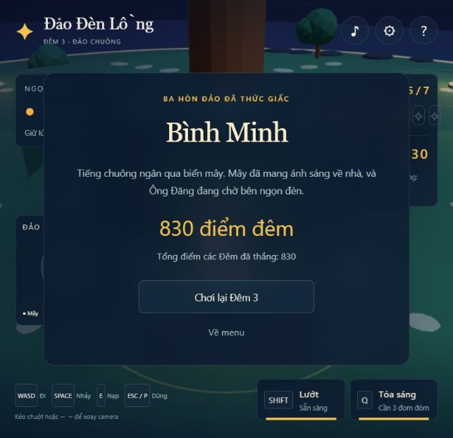

# Đảo Đèn Lồng · Đèn cạn dầu (Phase 3)

**Lê Gia Hưng · 2A202603713 · Contract 1.2**

Mục tiêu mới: **giữ đủ đèn sáng tới bình minh**, không còn thắng sớm khi thắp hết. Đêm 1 cần 3/5 đèn sau 240s, Đêm 2 cần 4/6 sau 270s, Đêm 3 cần 5/7 sau 300s. Hết lửa luôn thua, kể cả tick cuối.

Đèn có 100 dầu, hao 1/s. E ở đèn sáng để châm: mỗi đom đóm +10 dầu. Dưới 30 mất vùng an toàn, Bóng Mực wander có thể vào hút thêm 5/s/con; dùng Q xua chúng. Đèn tắt giữ lịch sử, thắp lại cần 5 thay vì 10 con. Mỗi lần thắp thành công tăng sức chứa 2, từ 10 đến tối đa 20. Thanh dầu và đèn dưới 30 nhấp nháy; đèn tắt xẹp20% và có vết rách.

Điểm: mỗi con nạp/châm +5; thắp đầu +100, thắp lại +40; pulse +5 mỗi bóng hoặc tổng +15 nếu đang hút. Khi thắng: mỗi đèn đang sáng +50+floor(dầu), mỗi lửa +50; không thưởng thời gian. Tổng hành trình chỉ cộng Đêm thắng.

Cài đặt **Bảng màu dễ phân biệt** được lưu: mắt/viền bóng00B3FF, cảnh báo trắng kèm⚠. Âm lượng/độ nhạy vẫn lưu như Phase2.

## Cài và chạy — 3 lệnh

Cần Node.js22+ và trình duyệt hỗ trợ WebGL2. Dùng cùng ba lệnh trên Windows/macOS/Linux:

```sh
npm ci
npm run build
npm start
```

Mở **http://localhost:5173**. Sau build không cần Internet/CDN/API key. `dist/` là bản web tĩnh tự chứa thư viện và license. Dev: `npm run dev`; sửa source thì build lại rồi refresh. Đổi cổng macOS/Linux: `PORT=8080 npm start`; PowerShell: `$env:PORT=8080` rồi `npm start`.

## Chơi như thế nào

| Phím / thao tác | Hành động |
|---|---|
| WASD, ↑/↓ | Đi theo camera |
| Space | Nhảy khi chạm đất |
| Shift | Lướt14m/s trong0,2s, hồi1,5s từ lúc bắt đầu |
| E | Nạp hoặc châm dầu vào đèn nhận được gần nhất trong 2 m |
| Q | Tỏa Sáng: tốn3 đom đóm, hồi3s |
| Kéo chuột, ←/→ | Xoay camera |
| Esc / P / ? | Tạm dừng; Tiếp tục / Chơi lại Đêm / Cài đặt / Về menu |
| ⚙ | Âm lượng, độ nhạy chuột; tự lưu giữa các lần mở |

Tự nhặt trong 1 m, chênh cao ≤1,5 m; sức chứa từ 10 tới 20 theo số lần thắp. Một đèn cần10, thắp lại5; nạp từng phần và châm dầu được. Đèn có ít nhất 30 dầu tạo vùng an toàn 6 m; đèn yếu mất vùng. Gió Lạc vẫn bay vào. Tỏa Sáng đo3D từ chân Mây+0,8m, bán kính5m; choáng2s, đẩy4m trong0,25s. Không bất tử khi Lướt.

Giữ đủ số đèn sáng ở tick bình minh để thắng; hết 3 ngọn lửa thua ngay, hết giờ thiếu đèn thì thua. Bị Bóng Mực chạm mất1 lửa, rơi nửa số đang mang: nhặt lại được trong8s, bất tử1,5s. Rơi xuốngY<-10 mất1 lửa và toàn bộ đom đóm, chờ1s hồi sinh; rơi bỏ qua bất tử. Tick cuối vẫn tính hao dầu, châm dầu và sát thương trước khi xét kết quả.

Menu → giới thiệu tên đảo và lời Ông Đăng → chơi → kết quả → Đêm kế tiếp. Thua chơi lại đúng Đêm đó. Thắng Đêm3 hiện **Bình Minh** và tổng điểm các Đêm đã thắng; replay không cộng trùng.


## Kiểm thử và headless

```sh
npm run verify
npm run evidence
node src/headless.mjs --seed 2026 --night 3 --ticks 18000 --out night3.jsonl
```

66 test và19 scenarioCLI thật (dầu, hút, châm, thắp lại, sức chứa, pause, ranhgiới bìnhminh từngĐêm), rawoutput/hashes ở [bằng chứng](docs/proof/phase-3/README.md). Renderer vàCLI cùngsrc/core.js; fixed60Hz, pause chỉ tăng outertick, inputframe giữ trường/edge, errorformat mã2, endbắtbuộc, seedđịnhđịnh. Contract/source tuning ởgame.contract.json, không GPUchoheadless.

BrowserQA đã thấy châm dầu đúng, checkboxmàu lưu qua reload, Đêm3 scenario5/7 vẫnplaying khi còngiờ và chỉ thắng lúc00:00. FPS1280×720 vẫn chưa có mẫu hợp lệ từPhase2; không coi headless làFPS. Chi tiếtgiới hạn ởghi chép.



## Tình huống UI kiểm chứng

- `/?scenario=refuel`: E châm đèn85dầu, túi10.
- `/?scenario=relight`: đèn cạn ngaytick1, E thắp lại với5con.
- `/?scenario=drain-pulse`: Q trúng bónghút, +15.
- `/?scenario=campaign`: mỗiĐêm4giây, đènsetup gầnngưỡng; E thắp thêm1rồi chờbìnhminh; cóthểđi qua3Đêm.
- `/?night=3&scenario=campaign`: đi thẳng tớiĐêm3 chỉđểQA, đượcghi nhãn rõ; `/`chơi từĐêm1.

## Tài liệu và harness

[ADR003](docs/adr/003-lantern-fuel-and-dawn.md) mô tả mô hình dầu, trạngthái vàtickorder. [Spec](docs/spec/phase-3.md), [nhật ký vàtestthay thế](docs/notes/phase-3.md), [breaking changes](CHANGELOG.md). Không skiptestđỏ. AGENTS/pre-commit/CI được cậpnhật; prooftagPhase1/2 giữnguyên. CI build/test/headless trênLinux/macOS; chưacoi runxanh nếu chưaquan sát.

## Sáng tạo của tôi

Giữ Mây nónlá/đènnhỏ, đườngđá/bếngỗ, bảnđồ, nhạc WebAudio vàvệtLướt. Thêm thanh dầu vàvếtrách đểtrạngtháiđèn đọcđược khôngcầnmàu. Phầnhiểnthị khôngthêmthựcthể/đổiseed haylogicheadless. Bảnđồchuẩn giữnguyên ĐảoBến/ĐảoCau/ĐảoChuông. Không đọc hayđoán Phase4; videovàReleasev1.0.0 ởbàngiaoPhase4.

[CREDITS](CREDITS.md) · [MIT](LICENSE).
