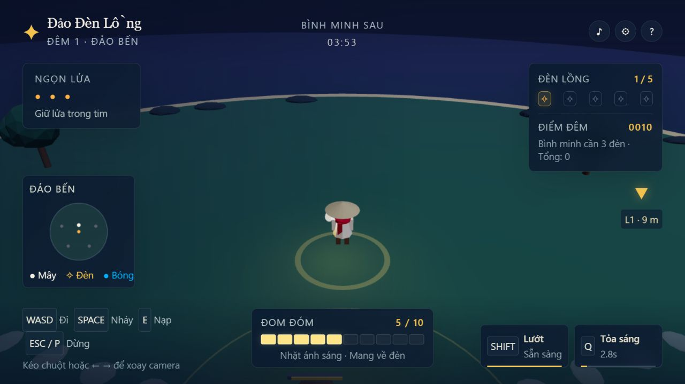

# Đảo Đèn Lồng · v1.0.0

**Lê Gia Hưng · 2A202603713 · Day 12 AI SDLC · Contract 1.3**

[Tải video demo MP4 (1 phút 12 giây)](https://github.com/LeGiaHung29805/K5-L3A-DAY12-LeGiaHung-2A202603713-AI-SDLC-Dao-Den-Long/releases/download/v1.0.0/dao-den-long-demo.mp4) · [Bản phát hành v1.0.0](https://github.com/LeGiaHung29805/K5-L3A-DAY12-LeGiaHung-2A202603713-AI-SDLC-Dao-Den-Long/releases/tag/v1.0.0)

Game 3D cổ tích: cùng Mây gom đom đóm, thắp đèn và giữ đảo sáng tới bình minh. Chơi lần lượt Đêm 1 — Đảo Bến, Đêm 2 — hai đảo Đảo Cau nối bằng cầu tre, Đêm 3 — Đảo Chuông nhiều tầng. Thắng Đêm trước mới mở Đêm sau.



## Cài đặt và chạy

Cần Node.js **22+**, npm và trình duyệt **WebGL 2** có tăng tốc đồ họa. Windows/macOS/Linux dùng cùng ba lệnh trong repo vừa clone:

```sh
npm ci
npm run build
npm start
```

Mở **http://localhost:5173**. Build sao chép Three.js và giấy phép vào dist; chơi không cần CDN, tài khoản hay API key. Sửa source: build lại và tải lại trang. Dev: npm run dev. Headless/soak không cần GPU.

[Release v1.0.0](https://github.com/LeGiaHung29805/K5-L3A-DAY12-LeGiaHung-2A202603713-AI-SDLC-Dao-Den-Long/releases/tag/v1.0.0) có ZIP dựng sẵn: giải nén, chạy `node scripts/serve.mjs`, mở địa chỉ trên; không cần npm install. Có thể phục vụ riêng dist bằng static server; khi đó bảng điểm chỉ lưu trong trình duyệt, xuất bằng nút **Xuất JSON**.

## Điều khiển và luật chơi

| Phím mặc định | Hành động |
|---|---|
| W/A/S/D, ↑/↓ | Đi theo camera |
| Space / Shift | Nhảy / Lướt |
| E | Nạp đèn hoặc châm dầu ở đèn nhận được gần nhất trong 2 m |
| Q | Tỏa Sáng, tốn 3 đom đóm; xua và làm choáng Bóng Mực |
| P / Esc | Tạm dừng/tiếp tục, menu chơi lại và hướng dẫn |
| Kéo chuột, ←/→ | Xoay camera |
| ⚙ | Đổi 9 phím, âm lượng, độ nhạy, bảng màu, giảm chuyển động, chữ lớn |

Phím đổi được lưu, phát hiện trùng và có nút khôi phục. HUD/hướng dẫn trong Đêm hiển thị phím đã chọn. Giảm chuyển động tắt nhấp nháy và chuyển động camera trang trí; chữ lớn tăng 1,25 lần. Cảnh báo hình ảnh báo bóng xuất hiện, hướng ngoài màn hình, gió, 10 giây cuối và dầu thấp.

Đèn mới cần 10 đom đóm, thắp lại cần 5. Đèn có 100 dầu, hao 1/giây; mỗi con châm thêm 10. Dưới 30 mất vùng an toàn, bóng wander có thể hút 5 dầu/giây/con. Sức chứa tăng từ 10 tới 20 theo số lần thắp. Thắp hết không thắng sớm: sau 240/270/300 giây cần còn sống và có ít nhất 3/5, 4/6, 5/7 đèn sáng. Hết 3 Ngọn Lửa thua ngay. Rơi/gió/Lướt/Bùa Gió/Gió Lạc giữ luật Phase 2.

Điểm: mỗi con nạp/châm +5; thắp mới +100, thắp lại +40; mỗi bóng trúng Tỏa Sáng +5 hoặc tổng +15 nếu đang hút. Khi thắng: mỗi đèn +50+floor(dầu), mỗi lửa +50. Tổng hành trình cộng các Đêm đã thắng, không cộng trùng replay.

Thua bất kỳ Đêm hoặc thắng Đêm 3 được nhập tên `[A-Za-z0-9_]{3,12}`. Top 10 xếp điểm giảm dần, đồng điểm ưu tiên thời điểm sớm hơn. Dữ liệu lưu localStorage và, khi chạy server đi kèm, .local/leaderboard.json; không gửi ra Internet. Xuất dữ liệu server:

```sh
node scripts/serve.mjs --export-leaderboard out.json
```

## Kiểm thử và headless

```sh
npm run verify
npm run evidence
node src/headless.mjs --seed 2026 --night 3 --ticks 18000 --out night3.jsonl
```

73 test logic/CLI và 19 scenario CLI hồi quy; fixed 60 Hz chung browser/Node. --scenario, --inputs, --snapshot-every theo contract; snapshot 0 trước input, end JSONL bắt buộc, sai định dạng mã 2. Core Phase 3 giữ nguyên. [Bằng chứng Phase 4](docs/proof/phase-4/README.md) không ghi đè proof/tag cũ. CI chạy Linux/macOS.

## Benchmark và soak

```sh
node scripts/bench.mjs --seed 42 --duration 30 --out bench.json
npm run soak -- --seed 7 --nights 10 --out soak.json
```

Benchmark tự mở tab local. Giữ tab hiển thị ở 1280×720 và đóng các cảnh 3D khác. Khi dùng `--no-open`, mở ngay `http://localhost:5174/` (hoặc cổng đã chọn bằng `--port`) để vào phiên đo đang chạy. Warmup 3 giây rồi đo đúng thời lượng với 200 bóng wander, 100 đom đóm và L1–L3 sáng. Cảnh đo tắt tiêu hao dầu, gameplay, spawn và input. Camera bán kính 30, cao 15, quay ngược chiều kim đồng hồ nhìn từ +Y với -Z phía trên, chu kỳ 15 giây. Instancing giữ nguyên mô hình, ánh sáng và số thực thể.

Web không có API ép tắt vsync/đo RSS tiến trình: khai vsync_off:false, peak_mem_mb:null. bench.frames.json có raw dt và SHA-256 trong bench.json; FPS = 1000N/sum(dt), 1% low dùng ceil(1%N) khung chậm nhất, P95 nearest-rank. Chỉ cắt hai khung biên để đo đúng thời lượng. load_ms bao gồm cả chờ mở browser từ lúc tiến trình chạy, không trừ độ trễ công cụ.

Soak chạy 10 Đêm một tiến trình, seed 7…16, đảo 1→2→3, đổi hướng mỗi 30 tick và xác suất hành động theo Ticket 04. Runner công khai --jitless --expose-gc --max-semi-space-size=1 --max-old-space-size=32: tắt JIT để giảm code-cache làm nhiễu RSS, GC tại hai mốc world; không thay mô phỏng. Lần chạy có JIT ban đầu vượt 20%; xem ADR004. Bot ngẫu nhiên không được bảo đảm thắng. Vượt ngưỡng RSS vẫn exit 1.

Đọc số đo thực tế và giới hạn tại [báo cáo](docs/proof/phase-4/README.md). Không coi headless timing là FPS hay coi mục tiêu máy giảng viên đã đạt trên mọi máy.

## Bàn giao

URL QA ghi nhãn tình huống: /?scenario=refuel, relight, drain-pulse, near-loss, accessibility; /?night=3&scenario=wind; /?scenario=campaign rút ngắn Đêm để thử luồng. Luồng / luôn bắt đầu Đêm 1, thắng mới sang Đêm 2.

[Bảng truy vết và cách tái tạo bằng chứng cho bốn phase](docs/proof/rubric.md).

## Sáng tạo của tôi

- **Đèn tắt đổi hình dáng.** Lồng đèn xẹp và lộ vết rách để người chơi nhận ra đèn đã tắt qua hình dáng. Mở `/?scenario=relight`, quan sát đèn tắt rồi nhấn **E** trong tầm tương tác để so sánh trước và sau. [Bằng chứng headless của ca thắp lại](docs/proof/phase-4/regression/relight.jsonl)
- **Minimap theo địa hình từng Đêm.** Bản đồ thu nhỏ giúp định hướng khi đèn nằm ngoài khung hình. [Ảnh gameplay](docs/proof/phase-4/gameplay.jpg)

Hai chi tiết nằm ở lớp hiển thị. Core và kết quả headless được đối chiếu qua [19 ca hồi quy](docs/proof/phase-4/regression/summary.json).

[CHANGELOG](CHANGELOG.md) · [Retro](docs/retro-phase-4.md) · [ADR dầu/bình minh](docs/adr/003-lantern-fuel-and-dawn.md) · [ADR release](docs/adr/004-release-measurements.md) · [CREDITS](CREDITS.md) · [MIT](LICENSE). Harness công khai: AGENTS.md, pre-commit fail-closed, tests, evidence scripts, GitHub Actions. MP4/ZIP/checksum và hướng dẫn trong Release.
